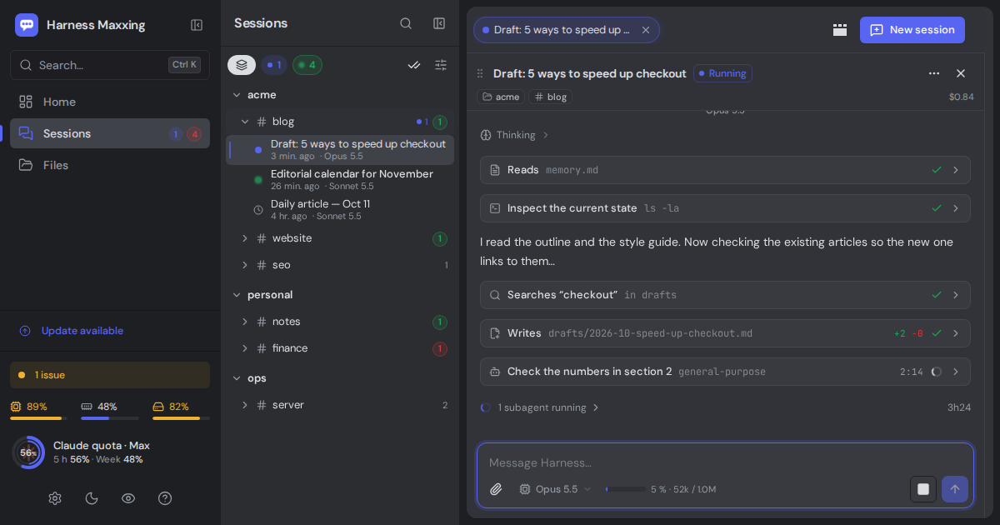
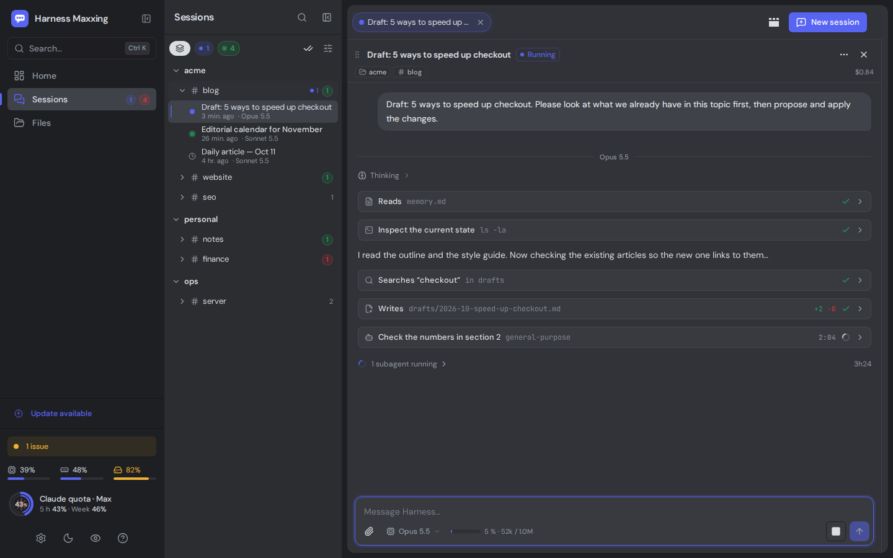
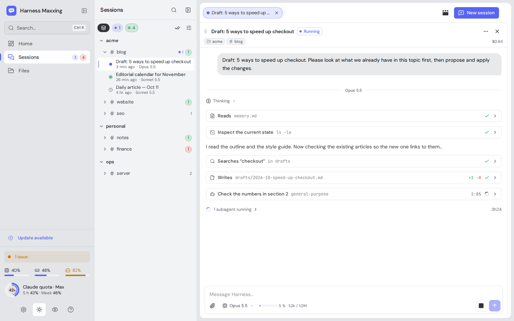
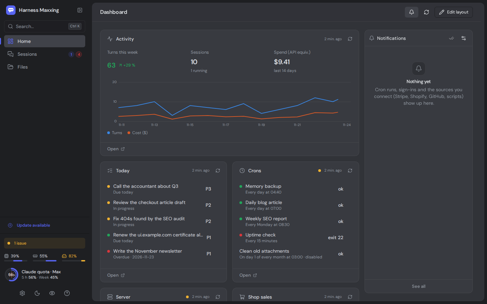
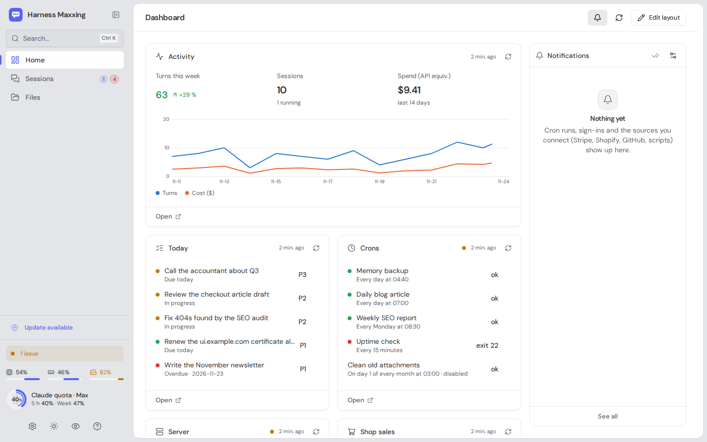

# Discord theme for Harness Maxxing

Discord-inspired colors for [Harness Maxxing](https://harness-maxxing.com): deep slate panels, a blurple accent,
dark and light modes. Values only (no advanced CSS), so it keeps working after every update.



## Install

Ask Harness in any session:

> Install the theme https://github.com/romainmaxxing/harnessmaxxing-theme-discord

or from the server:

```bash
git clone --depth 1 https://github.com/romainmaxxing/harnessmaxxing-theme-discord /tmp/discord-theme
maxxing themes check /tmp/discord-theme
maxxing themes install /tmp/discord-theme
```

Then pick **Discord** in Settings -> Appearance -> Theme.

## What it sets

- Dark: frame `#1e1f22`, list `#2b2d31`, panel `#313338`, cards `#383a40`, text `#dbdee1`, accent `#5865f2`.
- Light: frame `#e3e5e8`, list `#f2f3f5`, panel `#ffffff`, text `#313338`, accent `#5865f2`.
- 8 px corners, DM Sans interface font, JetBrains Mono for code, dark mode by default.
- Its own logo (a chat bubble) in the sidebar while the theme is in use.

## Screenshots

| Dark | Light |
|---|---|
|  |  |
|  |  |

Screenshots show demo data only.

Not affiliated with or endorsed by Discord Inc. "Discord" is a trademark of its owner; this theme only borrows a
color palette.

## License

MIT
