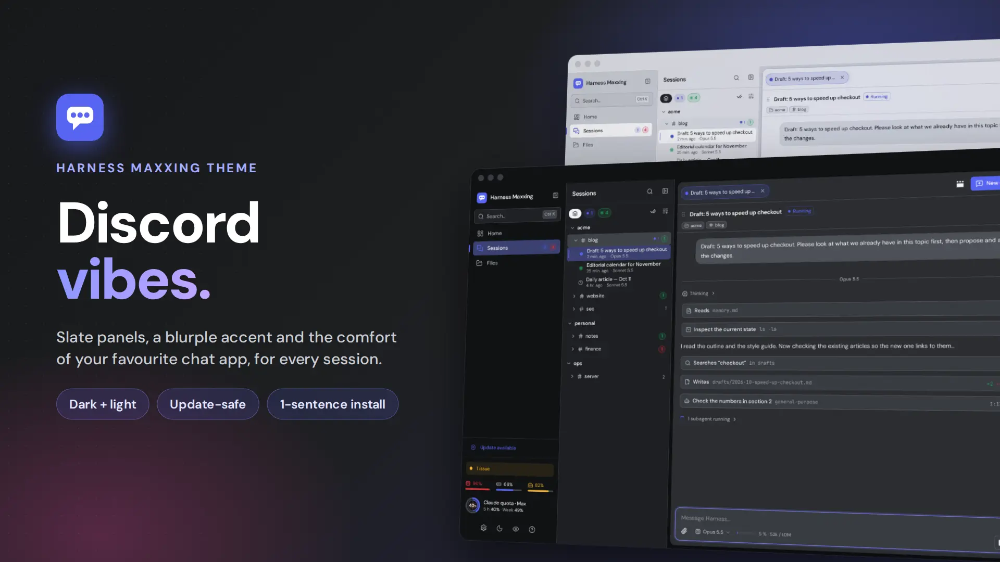
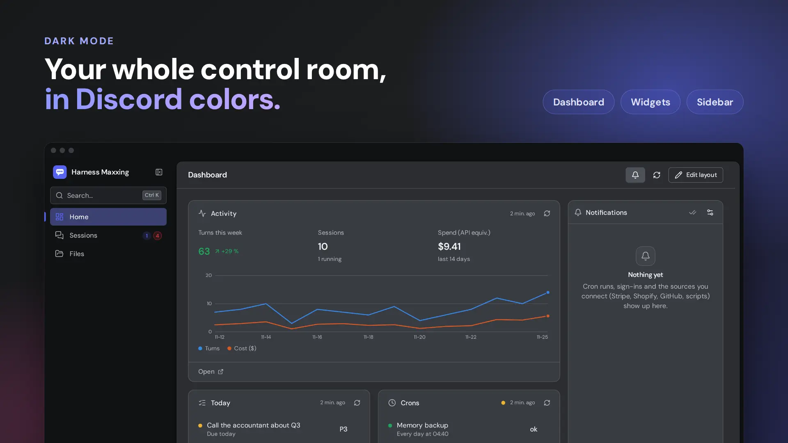
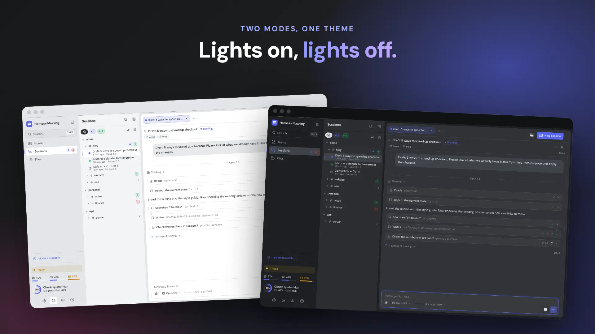
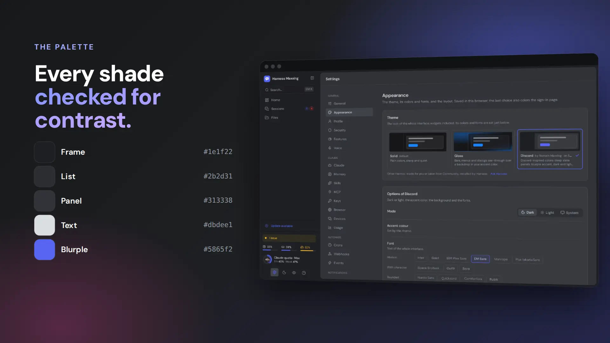
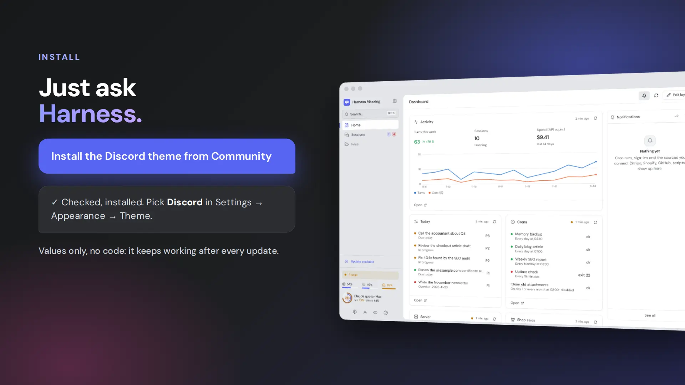

# Discord theme for Harness Maxxing

Discord-inspired colors for [Harness Maxxing](https://harness-maxxing.com), with strong contrast: clearly stepped slate
panels, raised cards, a blurple accent and blurple selection, dark and light modes. Values only (no advanced CSS), so it keeps working after every update.



## Install

Ask Harness in any session:

> Install the theme https://github.com/romainmaxxing/harnessmaxxing-theme-discord

or from the server:

```bash
git clone --depth 1 https://github.com/romainmaxxing/harnessmaxxing-theme-discord /tmp/discord-theme
maxxing themes check /tmp/discord-theme
maxxing themes install /tmp/discord-theme
```

Then pick **Discord** in Settings -> Appearance -> Theme.

## What it sets

- Dark: frame `#111214`, list `#1e1f22`, panel `#2b2d31`, cards `#3a3c43`, text `#f2f3f5`, secondary text `#b5bac1`,
  accent `#5865f2`, selected row `#3b4170`.
- Light: frame `#cdd0d6`, list `#e1e3e7`, panel `#eaecef`, cards `#ffffff`, text `#1e1f22`, secondary text `#4e5058`,
  accent `#4752c4`, selected row `#dde0ff`.
- Visible borders and shadows so cards, menus and fields stand out.

Version 1.1.0 raised the contrast between every level (1.0.0 was too flat). Screenshots below show 1.0.0.
- 8 px corners, DM Sans interface font, JetBrains Mono for code, dark mode by default.
- Its own logo (a chat bubble) in the sidebar while the theme is in use.

## Screenshots






Raw captures: [`screenshots/`](screenshots/). Screenshots show demo data only.

Not affiliated with or endorsed by Discord Inc. "Discord" is a trademark of its owner; this theme only borrows a
color palette.

## License

MIT
